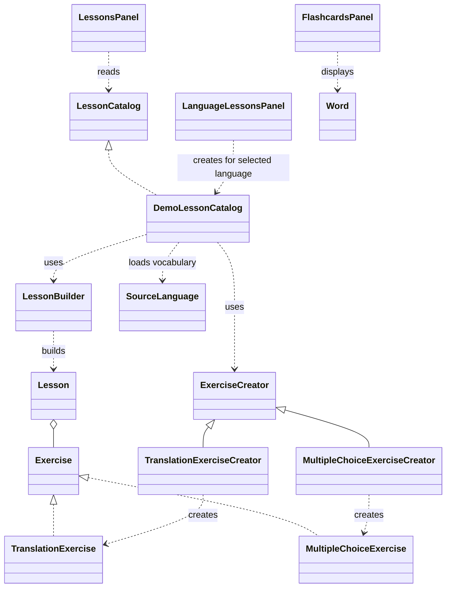

# Lesson architecture

Factory Method creates exercises; Builder assembles them into lessons.
SourceLanguage selects a UTF-8 vocabulary resource without modifying shared models.
The session and progress modules remain the other team members' responsibility.
