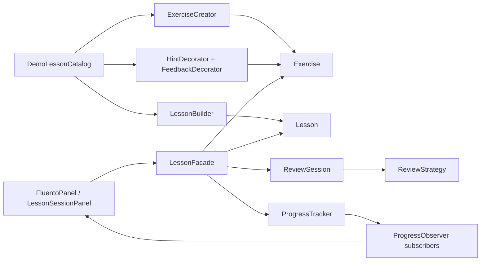

# Integrated architecture
The original Factory Method and Builder module is retained and connected to the
session, review, progress and decorator modules.

See docs/uml for UML class and sequence diagrams with explicit relationship notation.
