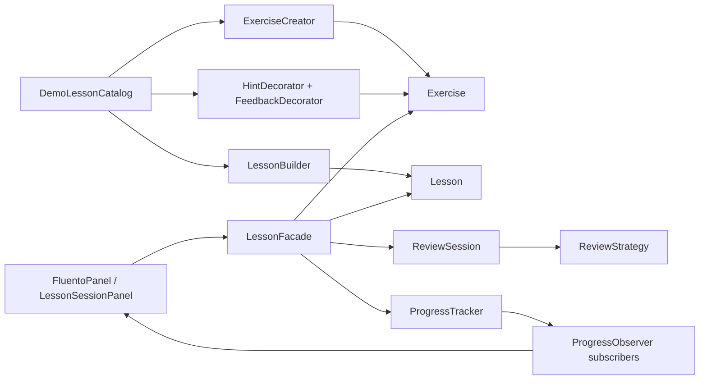

# Integrated architecture
The original Factory Method and Builder module is retained and connected to the
session, review, progress and decorator modules.

See docs/uml for UML class and sequence diagrams with explicit relationship notation.

## Package hierarchy
Only com.fluento.Main is outside the six pattern roots.
- factory: exercise creators and products; shared values in factory.model.
- builder: LessonBuilder; vocabulary and topic catalog in builder.catalog.
- strategy: ReviewStrategy implementations and ReviewSession.
- observer: progress tracking, snapshots and observer contracts.
- decorator: HintDecorator and FeedbackDecorator.
- facade: LessonFacade; views in facade.ui and examples in facade.demo.

The package dependency UML is docs/uml/05-package-structure.puml (SVG included).
PackageStructureTest checks root placement and directory/declaration consistency.
